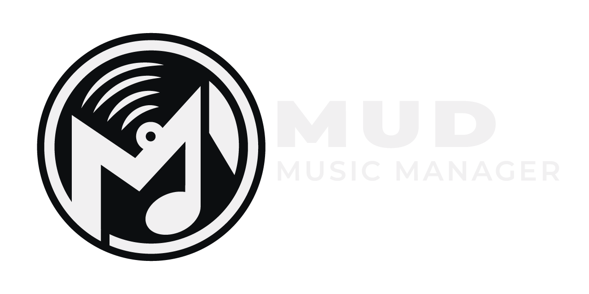

Mud Music Manager is a desktop app that keeps a local music folder in sync with a playlist or album on
**Spotify, YouTube, YT Music, SoundCloud, Apple Music or Amazon Music**: new songs are added, removed songs
are taken out, track numbers follow the playlist's order, and every file is tagged (title, artist, album,
year, cover art, lyrics). This project was made possible with Claude Code.

* [INSTALLATION](#installation)
    * [Release Files](#release-files)
    * [Running from source](#running-from-source)
* [USAGE](#usage)
* [DOWNLOAD CONFIGURATION](#download-configuration)
* [CONTRIBUTING](#contributing)
    * [Reporting a bug](#reporting-a-bug)
    * [Requesting a feature](#requesting-a-feature)
    * [Contributing code](#contributing-code)
* [ROADMAP](#roadmap)
* [FAQ](#faq)

# INSTALLATION

[-lightgrey.svg?style=for-the-badge&logo=apple)](#roadmap "On the roadmap")
[-lightgrey.svg?style=for-the-badge&logo=linux)](#roadmap "On the roadmap")

> [!NOTE]
> Mud Music Manager currently supports **Windows x64 only** (Windows 10 or later). Support for **macOS** and
> **Linux** is planned for a future release; see the [ROADMAP](#roadmap) for upcoming platforms and features.

Download the installer or the portable `.zip` from the [latest release](https://github.com/Michael-Shwerby/Mud-Music-Manager/releases/latest).
Both include everything the app needs (Python, FFmpeg and Deno are bundled), so nothing else has to be installed.

## RELEASE FILES

#### Recommended

File|Platform|Description
:---|:---|:---
[MudMusicManager-Setup-&lt;version&gt;.exe](https://github.com/Michael-Shwerby/Mud-Music-Manager/releases/latest)|Windows x64|Installer (recommended for **Windows**). Adds a Start-menu shortcut, an optional desktop shortcut and an uninstaller

#### Alternatives

File|Platform|Description
:---|:---|:---
[MudMusicManager-Portable-&lt;version&gt;.zip](https://github.com/Michael-Shwerby/Mud-Music-Manager/releases/latest)|Windows x64|Portable version: unzip anywhere (e.g. a USB drive) and run, no installation. Keeps all its data in its own folder

#### Misc

File|Description
:---|:---
[SHA256SUMS.txt](https://github.com/Michael-Shwerby/Mud-Music-Manager/releases/latest)|SHA-256 fingerprints of the release files, to check a download is complete and unchanged

> [!NOTE]
> The app isn't code-signed yet, so Windows SmartScreen may show "Windows protected your PC" the first time.
> Choose **More info → Run anyway** to continue.

## RUNNING FROM SOURCE

- Python 3 (developed and tested on Python 3.14, on Windows)
- The libraries in `requirements.txt`: `pip install -r requirements.txt`
- [FFmpeg](https://ffmpeg.org) on your PATH

Then double-click `Mud Music Manager.pyw`, or run `python main.py` (graphical app).
`python main.py --cli` opens the terminal menu.

# USAGE

<!-- Guides and diagrams coming soon. -->
N/A

# DOWNLOAD CONFIGURATION

<!-- Screenshot and explanation of the download settings coming soon. -->
N/A

# CONTRIBUTING

Bug reports, ideas and code are all welcome. A few good practices keep things easy to follow:

## Reporting a bug

1. **Check it isn't already reported.** Search the [open and closed issues](https://github.com/Michael-Shwerby/Mud-Music-Manager/issues?q=is%3Aissue) first.
2. **Use the latest version.** Use **Check For Updates** in the app; the bug may already be fixed.
3. **Open one issue per bug**, with a short, specific title (e.g. *"SoundCloud playlist sync skips the last track"*, not *"sync broken"*).
4. **Include:**
    * the Mud Music Manager version (shown in Settings) and how you installed it (installer, portable or source);
    * your OS Version;
    * the platform the playlist is on (Spotify, YouTube, …) and, if it's public, a link to it;
    * the steps to reproduce it, what you expected, and what happened instead;
    * the relevant part of the log (from the `logs` folder) or a screenshot of the error.
5. **Remove personal information** from logs and screenshots (usernames, private playlist links, folder paths you'd rather not share, cookies).

## Requesting a feature

* Check the [ROADMAP](#roadmap) and existing issues first to see if the feature is planned or involves an ongoing issue before requesting a feature.
* Explain the **problem** you're trying to solve, not only the solution you have in mind; there may be a simpler way.
* Keep each request to **one feature** so it can be discussed and tracked on its own.
* Ensure that the feature will actually be useful and not just a cool idea for the app. Request features that one might require and use.

## Contributing code

* **Keep pull requests focused:** one fix or feature per pull request, no unrelated reformatting.
* **Match the existing style:** naming, comments and structure like the surrounding code.
* **Don't remove or change existing features** without discussing it in an issue first.
* **Test your change** in the running app, and run the self-test (`python main.py --selftest`) before opening the pull request.
* **Never commit personal data:** `playlists.json`, `ui_settings.json`, logs, cookie files and similar are kept out by `.gitignore`; keep it that way.
* Describe in the pull request **what** changed, **why**, and **how you tested it**.
* By contributing, you agree your code is released under the project's [GPL-3.0 license](LICENSE.txt).

# ROADMAP

Possible features for future releases (not in any particular order, and not promises):

- [ ] **macOS & Linux support**
- [ ] **Music file format converter tool**
- [ ] **Live waveform viewer / editor:** a clipping tool to customise a song (cut parts out and add crossfades)
- [ ] **Mobile versions?**

Have an idea? See [Requesting a feature](#requesting-a-feature).

# FAQ

None yet

---

## Your responsibility

This app downloads audio from online services. You are responsible for using
it in line with those services' terms and the copyright law that applies to
you. Only download material you have the right to copy.

Mud Music Manager is not affiliated with, sponsored or endorsed by Spotify,
YouTube, SoundCloud, Apple or Amazon.

## Support the project

Mud Music Manager is free. If it's useful to you, you can support its
development through Ko-Fi, click the **Sponsor** button at the top of this
repository's GitHub page, or you can go there directly here: https://ko-fi.com/michaelshwerby

## License

Copyright (c) 2026 Michael Xuereb.

This program is free software: you can redistribute it and/or modify it under
the terms of the GNU General Public License as published by the Free Software
Foundation, either version 3 of the License, or (at your option) any later
version. It is distributed WITHOUT ANY WARRANTY; see [LICENSE.txt](LICENSE.txt).

"Mud Music Manager" and the MMM logo and emblem are trademarks of Michael
Xuereb and are not covered by the licence. Third-party libraries keep their
own licences; see [THIRD_PARTY_NOTICES.txt](THIRD_PARTY_NOTICES.txt).
